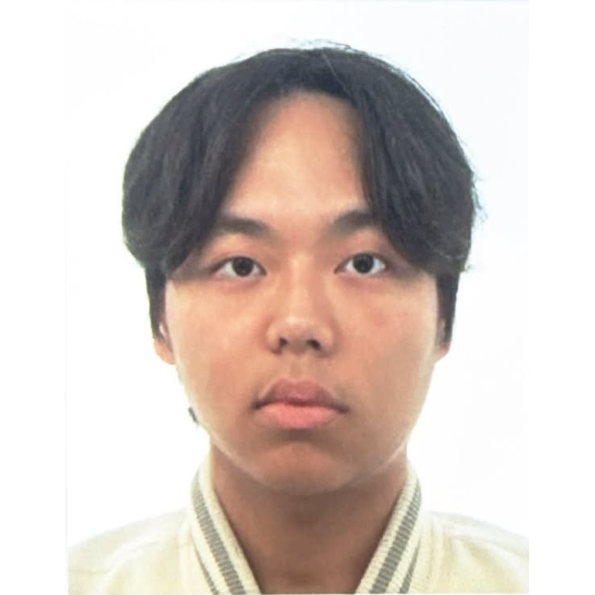

I'm Hyowoon Park, an undergraduate student in the Department of Computer Science and Engineering at Korea University. I'm currently exploring programming language theory to clarify my research interests, with a particular focus on the interplay between the constructs of language semantics.

## Educational Background
- 2026.03 ~ Present - B.S. of Computer Science and Engineering, Korea University

## Contact Information




