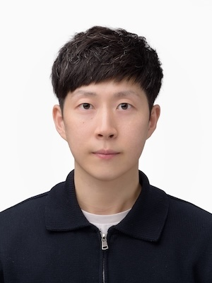

**I’m recruiting motivated graduate and undergraduate students, as well as
postdocs**, interested in programming languages and software engineering. See
[**Research**](/research) and [**Publications**](/publications) for details.

I'm an Assistant Professor at [**Programming Language Research Group
(PLRG)**](/), Dept. of Computer Science and Engineering, College of Informatics,
Korea University. I received my Ph.D. from KAIST under the supervision of [Prof.
Sukyoung Ryu](https://plrg.kaist.ac.kr/ryu). My research develops programming
language and software engineering techniques that make real-world software
reliable and secure, spanning language specifications, program analysis,
automated testing, type systems, program synthesis, and software security. I
also lead the open-source project [**ESMeta**](https://github.com/es-meta/esmeta),
which extracts a mechanized specification from the JavaScript language
specification ([ECMA-262](https://tc39.es/ecma262/)) and automatically generates
language tools from it; it runs in the CI of both ECMA-262 and Test262.

[[Curriculum Vitae (CV)](/assets/data/cv/cv_jihyeok_park.pdf)]

## Educational Background

- 2016.03 ~ 2022.02 - Integrated M.S. & Ph.D. [School of Computing](https://cs.kaist.ac.kr/), [KAIST](https://www.kaist.ac.kr/kr/)
  - Ph.D. Thesis - [JavaScript Static Analysis for Evolving Language Specifications](/assets/data/publication/thesis22-park.pdf)
  - Advisor: [Sukyoung Ryu](https://plrg.kaist.ac.kr/ryu)
- 2012.03 ~ 2016.02 - B.S. [School of Computing](https://cs.kaist.ac.kr/) and [Mathematical Sciences](https://mathsci.kaist.ac.kr), [KAIST](https://www.kaist.ac.kr/kr/)

## Employed Positions
- 2023.03 ~ Present - Assistant Professor, [Dept. of Computer Science and Engineering](https://cs.korea.ac.kr), [Korea University](https://www.korea.ac.kr)
- 2022.02 ~ 2023.02 - Post Doctoral Fellow, [Oracle Labs](https://labs.oracle.com), Australia

## Research Interest

<!--AUTO:topics (research topics, filled in by _next/build.mjs)-->

## Publications

<!--AUTO:venues (major venues from _data/publications.yml, filled in by _next/build.mjs)-->

## Professional Activities

- **Organizing Committee**
  - 2027 -
    [**SOAP** (Program Co-Chair)](https://pldi27.sigplan.org/)
  - 2025 -
    [**RPLS**](https://pldi25.sigplan.org/home/rpls-2025)
  - 2022 -
    [**ISSTA** (Web Co-Chair)](https://conf.researchr.org/home/issta-2022)

- **Committee Members**
  - 2027 -
    [**ICSE**](https://conf.researchr.org/home/icse-2027) /
    [**FSE**](https://conf.researchr.org/home/fse-2027)
  - 2026 -
    [**CCS**](https://www.sigsac.org/ccs/CCS2026/) /
    [**ASE**](https://conf.researchr.org/home/ase-2026) /
    [**ICSME**](https://conf.researchr.org/home/icsme-2026) /
    [**SOAP**](https://pldi26.sigplan.org/home/SOAP-2026) /
    [**PLDI**](https://pldi26.sigplan.org/) /
    [**SAC** (PL Track)](https://www.sigapp.org/sac/sac2026)
  - 2025 -
    [**OOPSLA**](https://2025.splashcon.org/track/OOPSLA) /
    [**SAS**](https://2025.splashcon.org/home/sas-2025) /
    [**SCAM**](https://conf.researchr.org/home/scam-2025) /
    [**SAC** (PL Track)](https://www.sigapp.org/sac/sac2025)
  - 2024 -
    [**APLAS** (SRC & Posters)](https://conf.researchr.org/track/aplas-2024/src-and-posters%3F) /
    [**SPLASH** (DS)](https://2024.splashcon.org/track/splash-2024-Doctoral-Symposium) /
    [**SAC** (PL Track)](https://www.sigapp.org/sac/sac2024) /
    [**ICSE**](https://conf.researchr.org/home/icse-2024)
  - 2023 -
    [**OOPSLA**](https://2023.splashcon.org/track/splash-2023-oopsla) /
    [**APLAS**](https://conf.researchr.org/home/aplas-2023)
  - 2022 -
    [**OOPSLA**](https://2023.splashcon.org/track/splash-2022-oopsla) /
    [**APLAS**](https://conf.researchr.org/home/aplas-2022)

- **Artifact Evaluation Committee Members**
  - 2023 -
    [**OOPSLA**](https://2023.splashcon.org/track/splash-2023-oopsla)
  - 2022 -
    [**OOPSLA**](https://2023.splashcon.org/track/splash-2022-oopsla)
  - 2019 -
    [**POPL**](https://popl19.sigplan.org/track/POPL-2019-Research-Papers) /
    [**OOPSLA**](https://conf.researchr.org/track/splash-2019/splash-2019-oopsla)
  - 2018 -
    [**OOPSLA**](https://conf.researchr.org/track/splash-2018/splash-2018-OOPSLA) /
    [**SAS**](https://staticanalysis.org/sas2018/sas2018.html) /
    [**ISSTA**](https://conf.researchr.org/home/issta-2018)

- **Journal Reviewers**
  - 2026 -
    [**ACM TOSEM**](https://dl.acm.org/journal/TOSEM)
  - 2025 -
    [**ACM TOSEM**](https://dl.acm.org/journal/TOSEM)
  - 2024 -
    [**IEEE TSE**](https://doi.org/10.1109/TSE.2024.3525202)
  - 2023 -
    [**IEEE TSE**](https://doi.org/10.1109/TSE.2023.3348716)
  - 2022 -
    [**IEEE TSE**](https://www.computer.org/digital-library/journals/ts/2022-reviewer-thanks)

## Invited Participants
- 2017.08 - [Shonan Meeting on Memory Abstraction](https://shonan.nii.ac.jp/archives/seminar/108/)
- 2018.07 - Internship Program in École Normale Supérieure ([Prof. Xavier Rival](https://www.di.ens.fr/~rival/))

## Honors & Awards
- **ACM SIGSOFT Distinguished Paper Award**, ASE 2026.
- **고려대학교 우수강좌**, COSE212 Programming Languages (2023-2)
- **Ph.D. Dissertation Award**, College of Engineering, KAIST, 2022.
- **An Outstanding Ph.D. Thesis**, School of Computing, KAIST, 2022.
- **ACM SIGSOFT Distinguished Paper Award**, ICSE 2021.
- **Ph.D. Fellowship Award**, NAVER Corp., 2020.
- **Outstanding Teaching Assistant Award**, KAIST CS320 Programming Languages  
  (2016-2 / 2017-1 / 2018-1 / 2018-2 / 2019-1).
- **Outstanding Teaching Assistant Award**, KAIST CS109 Programming Practice, 2016 Spring.
- **Best Paper Award**, SOAP 2017.
- **ACM Student Research Competition 3rd**, Modularity 2014.
- **KAIST Presidential Fellowship**, School of Computing, KAIST, 2013.

## Courses
Please see [**Courses**](/courses).

## Talks
Please see [**Talks**](/talks).

## Contact Information

Room 507, IT & General Education Center (정운오IT교양관) 
[Dept. of Computer Science and Engineering](https://cs.korea.ac.kr/)  
[Korea University](https://www.korea.ac.kr/)  
Anam-dong 5-ga, Seongbuk-gu  
Seoul 136-713, Korea  
(office) +82) 02-3290-4602

<!--contact-->
