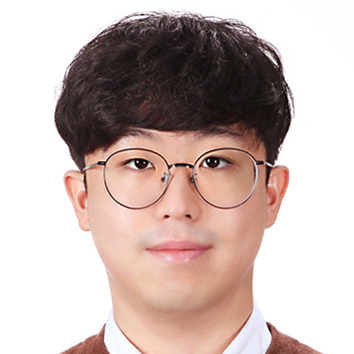

<!--former-member-->

I'm Seongjin Lee, an undergraduate student studying computer science in Korea University. 
Currently I am interested in programming languages, static analysis and automated testing.

## Educational Background
- 2019.03 ~ Present - B.S. of Computer Science and Engineering, Korea University

## Contact Information
<!--contact-->
