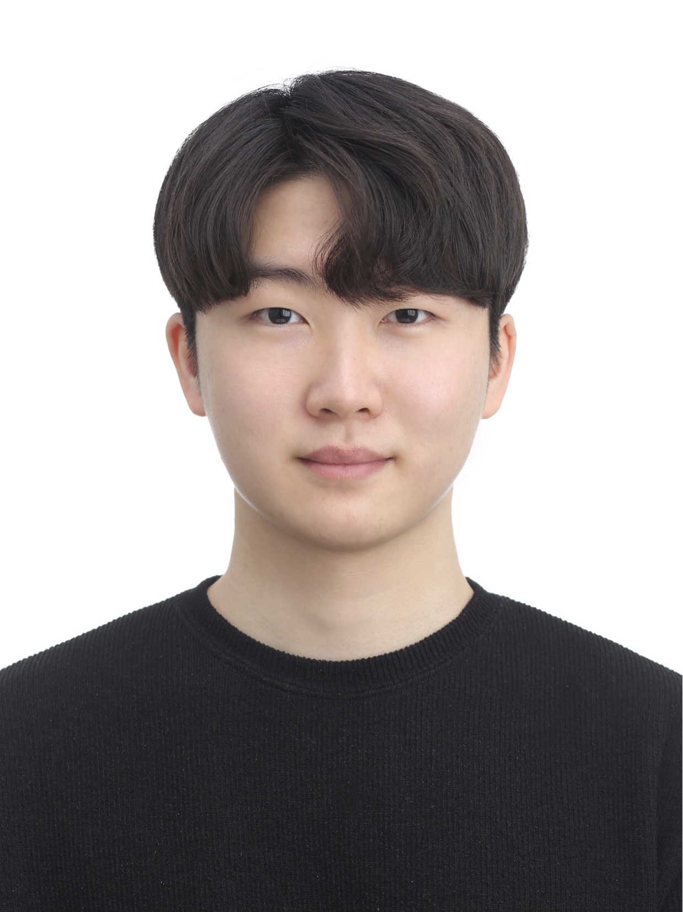

I'm Seongmin Ko, an Ph.D. student studying computer science in Korea University. 
Currently I am interested in programming languages, program synthesis, formal
languages and JavaScript ecosystem.

## Educational Background
- 2026.09 ~ Present - Ph.D. of Computer Science and Engineering, Korea University
- 2024.09 ~ 2026.08 - M.S. of Computer Science and Engineering, Korea University
- 2018.03 ~ 2024.08 - B.S. of Computer Science and Engineering, Korea University

## Contact Information
<!--contact-->

