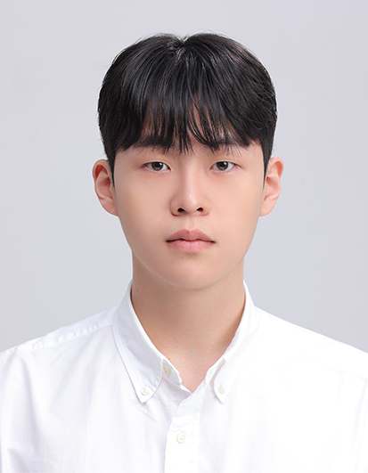

I'm Sungmin Park, a graduate student studying computer science in Korea University. 
Currently I am interested in programming languages and static analysis.

## Educational Background
- 2026.03 ~ Present - M.S. of Computer Science and Engineering, Korea University
- 2022.03 ~ 2026.02 - B.S. of Computer Science and Engineering, Double Major in Mathematics, Korea University

## Contact Information
<!--contact-->

